<div align="center">



[](https://mojiya.app)
[](https://mojiya.app/features)
[](mailto:support@mojiya.app)

</div>

```console
$ cat about.txt
```

I build Mojiya, a Japanese study app for Android, iOS, the web and the browser, from one Kotlin Multiplatform codebase.

- **Ship.** Solo-built, from the content pipeline to the store listings, on Android, iOS and the web, plus four browser extension stores.
- **Measure.** Study pacing comes from simulating a year of real FSRS reviews, not from guessing.
- **Build.** Content pipelines, sync backends, OCR and audio, end to end.

```console
$ ls projects/
```

| Project | What it does | Stack |
|---|---|---|
| [**Mojiya**](https://mojiya.app) | Kanji, vocabulary, grammar and kana courses with a dictionary, EPUB reader and subtitle player. The same features on every platform. | Kotlin · Compose Multiplatform · SQLite |
| [**Mojiya extension**](https://mojiya.app/features#extension) | Pop-up dictionary and subtitle mining on any page, with Anki export. Chrome, Edge, Firefox and Safari. | TypeScript · Kotlin/JS |
| **Sync relay** | Event-sourced progress sync across devices on an append-only log. | Kotlin · Ktor · PostgreSQL |
| **Content pipeline** | Eleven stages from JMdict, KANJIDIC2, KanjiVG, Tatoeba and Kanjium to a byte-reproducible database with 35,000+ voiced clips. | Python · SQLite · Amazon Polly |

All four are private. Mojiya ships through the Play Store, the App Store and [mojiya.app](https://mojiya.app).

```console
$ cat skills.txt
```

**Mobile**

   

**Domain**

  

**Stack**


**Runs on**

